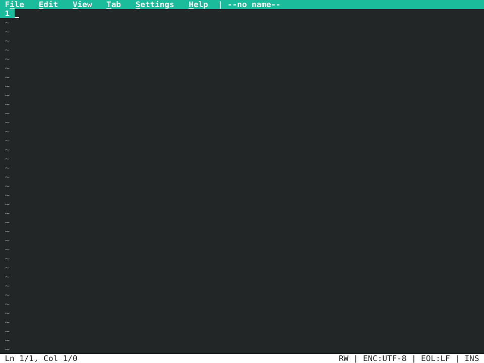
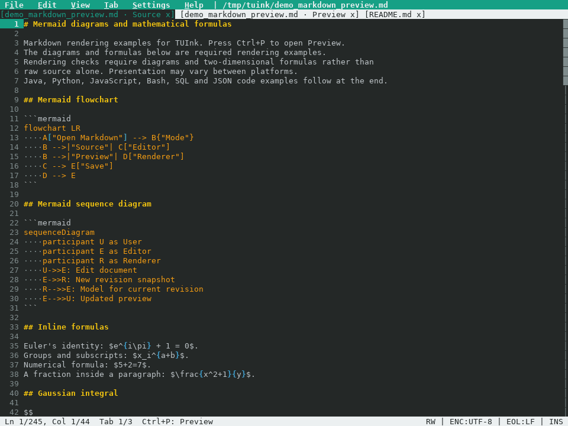

# TUInk

> **A familiar text editor that lives in your terminal.**

TUInk is a non-modal editor for people who want to stay in the terminal
without giving up familiar controls. Open a file and start typing: use ordinary
keyboard shortcuts, the mouse, menus, tabs, search and replace, syntax
highlighting, and a tree-based file picker without learning an editor command
language.

## TUInk in action

### Files and menus



### Tabs and syntax highlighting



## Why TUInk?

- **Start editing immediately.** TUInk is non-modal and uses conventional
  shortcuts for opening, saving, searching, copying, undoing, and redoing.
- **Use keyboard and mouse together.** Click, drag, Shift+Click, menus,
  scrollbars, and keyboard navigation work side by side.
- **Work with real-world Unicode.** Cursor movement and selection respect
  extended grapheme clusters, including emoji, combining characters, and wide
  CJK text.
- **Find and navigate quickly.** Work in multiple tabs, browse files in a tree,
  search across every tab, and replace matches in the active tab. Case,
  whole-word, and wildcard options help narrow the result.
- **Edit code comfortably.** TUInk provides syntax highlighting, line and word
  wrapping, auto-indent, autopairs, automatic lists, visible whitespace,
  rainbow brackets, and line-comment toggling.
- **See what changed.** Gutter markers distinguish edits since the last save
  from edits since the file was opened.
- **Protect unfinished work.** Recovery snapshots and file-aware saves retain
  detected encoding, BOM, line endings, and supported filesystem metadata.
- **Choose how to run it.** Use Java 25, a native Linux archive, or a Debian
  package.

## Try it

Local JVM builds use Java 25 from any vendor and an interactive terminal.
The Gradle wrapper can run on a compatible JDK, such as 17, 21 or 25, and
automatically downloads a Java 25 toolchain when needed.
The packaged JVM ZIP runs on Java 25 or newer. See the
[setup and transfer guide in Russian](docs/setup-ru.md) for a new computer.

Linux access ACLs are preserved directly through libc in both JVM and native
distributions; the `acl` package and a separate `libacl` library are not required.

```bash
./gradlew --console=plain :app:run
```

Open a file directly:

```bash
./gradlew --console=plain :app:run --args="README.md"
```

For a filename containing spaces, quote it inside Gradle's argument string:
`./gradlew --console=plain :app:run --args='"my notes.txt"'`.

Use `--` before a filename that starts with a dash, for example `tuink -- --notes.md`.
Arguments after `--` are treated as filenames, including names matching CLI options.

Run `./gradlew buildHelp` for the complete local build command reference.

## Highlights

### Familiar editing

- multiple tabs with mouse and keyboard navigation;
- a shared application clipboard for copying, cutting, and pasting between tabs;
- selection by keyboard, mouse drag, or Shift+Click;
- undo and redo;
- search across all tabs, with replacement in the active tab;
- menus, buttons, dialogs, text fields, trees, and scrollbars;
- configurable Cyan, Blue, and Light themes.

### Terminal-native behavior

- mouse input can be enabled or disabled;
- alternate-screen and monochrome modes are available;
- terminal state is restored after normal exit and handled failures;
- content is clipped safely when the terminal becomes very small;
- the native build works without a JVM on the target machine.

### Text and code

- grapheme-aware cursor movement, deletion, selection, wrapping, and hit
  testing;
- syntax highlighting for common programming, markup, data, and configuration
  formats;
- bracket matching, rainbow brackets, and visible whitespace;
- switchable line/word wrapping, auto-indent, autopairs, and automatic lists;
- two gutter-diff layers: `saved -> current` and `open -> current`.

Extremely long combining sequences are displayed as replacement glyphs while
the original text remains available for editing, copying, and saving.

Markdown list continuation and termination respect indented code blocks and
code fences, including fences nested in list items.
List markers accept spaces or tabs; continuation preserves their padding and
resets task checkboxes for `-`, `*`, `+`, and numbered lists.

For heavily changed documents, gutter markers can use a broader changed range
to keep editing responsive; unchanged lines inside that range may also be marked.

### File safety

Opening a file is limited to 64 MiB and may have a lower limit when available
heap memory is small or the file contains many lines. An oversized file reports
an error without changing open documents. Reads remain bounded if the file grows.

- Save As validation and overwrite confirmation;
- explicit handling of read-only files and dirty tabs;
- recovery snapshots for unfinished edits;
- preservation of detected charset, BOM, line-separator layout, and final-EOL
  state;
- preservation of existing POSIX permissions, owner/group, user-defined extended
  attributes, Linux POSIX access ACLs, and ACLs exposed by the filesystem provider;
- safe saving through symbolic links without replacing the link itself.

If an edit leaves an empty line between bare CR and LF endings, that empty
line's ending becomes CRLF so saving and reopening retain both line breaks.

Normal saves compare the destination with the bytes last opened or saved.
A change detected during these checks retains your edits and reports a
conflict. Use Save As with a different name to keep both versions, or reopen
the file. This check also applies to recovered documents. Locks coordinate
TUInk instances of the same user across configuration profiles. Other editors
do not use these locks: a change after the final check can still be overwritten.
Save As checks existing destinations with streaming reads. Longer checks and
save preparation show their progress and can be cancelled with Esc, retaining
the original file and your draft.
Before assigning a new filename, Save As checks open documents. A target belonging
to another tab must be saved from that tab or replaced with a different name. This
includes physical file aliases and filenames reserved by unsaved named documents.
Generated copy and numbered names fit a 255-byte filename budget, shortening the
base name before checking availability. Names entered manually remain exact.

If an edit cannot be encoded in the original charset, saving offers **Save as
UTF-8** with Cancel selected initially. The explicit conversion writes UTF-8
without a BOM and preserves existing line endings. It becomes a separate undo
step after a successful save; earlier text edits remain in history.
UTF-16LE files starting with NUL can share the exact bytes of UTF-32LE files.
For ambiguous input, choose Open UTF-16LE in the picker or pass
`--open-as-utf16le` for that file. UTF-32 editing is not supported.

Existing-file saves copy supported filesystem attributes to the staged file
before replacing the original. If those attributes cannot be preserved, saving
fails and the original is retained. Atomic replacement creates a new inode;
other hard links keep their previous contents.

Where the filesystem exposes Unix mode bits, saves also preserve `setuid`,
`setgid`, and `sticky`, including after content edits. The staged mode is
verified before replacement; a filesystem that clears a required bit causes
the save to fail while retaining the original.

Linux access ACLs are copied with their named entries and exact mask. If the
original has no extended access ACL, any ACL inherited by the staged file is
removed. The ACL and mode are verified before replacement; a failure reports
an error and retains the original file.
Saving and recovery retain the original bytes of Unix filenames, including
names which cannot be represented as UTF-8 text.
To open those names, use the file picker or pass an ASCII percent-encoded URI,
such as `tuink --file-uri='file:///path/legacy-%FF.txt'`. Ordinary command-line
paths containing `�` are rejected because the JVM may have already replaced
undecodable filename bytes with that character. This also applies to a literal
`�` in a filename; the file picker and encoded URI keep its identity exact.
The picker, tab titles and file confirmations use an escaped `file:` label when
native filename bytes or nonprinting characters cannot be displayed literally.
For example, `file:a%FF.txt` and `file:a%FE.txt` identify different native names;
an ordinary filename `a%FF.txt` remains literal. These short labels are for display;
Save As uses the complete absolute file URI. Encoded names must fit in an overwrite
confirmation before its action is available; enlarge the window when requested.

Syntax highlighting uses bounded scanning and output budgets. Long lines or
unavailable lexical context may be displayed as plain text so that highlighting
does not prevent opening and navigating the document.
Lexical nesting, continuation state and returned ranges also have fixed limits.
Exceeding a limit leaves the unknown region plain and suppresses uncertain bracket
errors rather than treating an incomplete scan as a complete document.
Resumable lexical context is completed in subsequent frames, including while
the editor is idle, when another bounded scan can retain useful progress.

Local edits share unchanged text blocks and Unicode indices instead of copying
an entire long line. Visible text is read by range. Initial indexing still reads
the line; word wrapping with tabs and some Unicode boundary changes can require
a long rescan. These cases do not have a constant-time responsiveness guarantee.

## Controls

| Input | Action |
|---|---|
| `Ctrl+O` | Open the tree-based file picker |
| `Ctrl+S` | Save the current file |
| `Ctrl+K` / `Ctrl+W` / `Ctrl+Shift+S` / `Ctrl+Shift+F4` | Save As |
| `Ctrl+X` / `Ctrl+C` / `Ctrl+V` | Cut / copy / paste using the application clipboard |
| `Ctrl+A` | Select all text in the focused document or text field |
| `Ctrl+Z` / `Ctrl+Y` | Undo / redo |
| `Ctrl+N` | Open a new tab |
| `Ctrl+Tab` / `Super+Tab` / `Ctrl+PageDown` | Select the next tab |
| `Ctrl+PageUp` | Select the previous tab |
| `Ctrl+F` | Open search and replace |
| `Ctrl+/` | Toggle line comments |
| `Ctrl+Q` | Quit, with confirmation for unsaved work |
| `F1` / `Alt+I` | Open the File menu |
| `F2` / `Alt+E` | Open the Edit menu |
| `F3` / `Alt+V` | Open the View menu |
| `F4` / `Alt+T` | Open the Tab menu |
| `F5` / `Alt+S` | Open the Settings menu |
| `F6` / `Alt+H` | Open the Help menu |
| Arrows / Page Up / Page Down / Home / End | Navigate the document |
| `Shift` + Arrow keys | Extend the selection |
| `Shift+Home` / `Shift+End` | Select to the line start / end, respecting Smart Home/End |
| `Ctrl+Home` / `Ctrl+End` | Move to the document start / end |
| `Ctrl+Shift+Home` / `Ctrl+Shift+End` | Select to the document start / end |
| `Ctrl+Left` / `Alt+B` | Move to the previous word |
| `Ctrl+Right` / `Alt+F` | Move to the next word |
| `Enter` / `Tab` | Insert a newline / tab |
| `Backspace` / `Delete` | Delete backward / forward |

Modified shortcuts work when the terminal sends distinct key sequences and the
desktop passes them through. For example, some terminals cannot distinguish
`Ctrl+Shift+S` from `Ctrl+S`, or `Ctrl+Tab` from `Tab`. Use another listed
shortcut when a combination is unavailable.

A standalone `Esc` can take up to half a second to act while TUInk waits for a
possible terminal key sequence. Unambiguous key sequences, including Alt
shortcuts, are handled immediately.

Mouse controls include click-to-position, drag selection, Shift+Click
selection from the previous cursor position, wheel scrolling, tab and menu
activation, scrollbar interaction, and file-picker navigation.
Holding a dragged pointer at an editor edge continues scrolling the selection
until the button is released or the gesture is cancelled.

Saving and copying preserve a manually scrolled document viewport. Each tab
remembers its own viewing position; navigation and editing resume following
the text cursor. Resizing wrapped text preserves the text position at the top
of the viewport. Editing commands rejected in reading mode leave the viewing
position unchanged. Keyboard input ends an active mouse drag before handling
the key.

Each tab also retains its search text, replacement, options, dialogs, and control
focus. Tab shortcuts and tab-bar clicks remain available while search, Save As,
the file picker, help, or a document confirmation is open. Return to the tab to
resume its controls. Quit confirmation and startup recovery apply to the whole
application.
Tab titles and the Tab menu show `?` for a pending dialog, `/` for open search,
`#` for search matches, and `*` for unsaved changes, including on inactive tabs.

With line wrapping enabled, Up/Down and Page Up/Page Down navigate displayed
rows; Shift+Up/Down extend the selection by displayed rows. A fully filled
final wrap segment has an extra empty row for the cursor after the text.

Without a selection, `Ctrl+C` copies the current line and `Ctrl+X` cuts it.
On an empty final line both operations do nothing and preserve the clipboard;
empty lines with a line ending are still copied or cut.
Close a tab through Tab > Close Tab.

With the search panel focused, use `Ctrl+F` for the next match, `Ctrl+G` for the previous
match and `Ctrl+R` to replace. Activate the `Replace all` button to replace all matches
in the active tab.
The `All tabs` option extends matching and next/previous navigation to all open tabs.
`Replace` and `Replace all` change the active tab.
A result in another tab carries a copy of the current query, replacement, and
options into that tab. The original tab keeps its search; later edits to either
tab's controls are independent. Ordinary tab switching leaves each search unchanged.
`Enter` advances to the next match from a text field. Enter or Space activates
the focused button, including option toggles. `Tab` and
`Shift+Tab` cycle through fields, options, buttons, and the document; `Esc`
closes search. Clicking a search control or the document also moves focus.
With the document focused, ordinary editing and `Ctrl+Z` / `Ctrl+Y` work
while search stays open; `Tab` continues to move focus. Undo and redo are
ignored throughout the search panel. `Ctrl+F` returns focus to Find.
After `Replace all`, close search with `Esc` before using `Ctrl+Z` to undo it.
Single and bulk replacements check the proposed result against available memory before
changing text or history. If the result is too large, the editor reports an error;
reduce the number of matches or shorten the replacement and try again.
Pasting uses the same admission policy and preserves the selection, text, and
undo history when there is insufficient memory.
Keyboard edits, including typing assists and cutting, also prepare their text,
line-ending metadata and undo records before publishing a change. A rejected
edit reports an error and preserves the draft, clipboard and viewing position.

Large terminal pastes are read in bounded portions so that rendering, resizing
and stop requests can still be handled. The complete paste is inserted as one
undo step; oversized pastes are drained and rejected without inserting a prefix.

With Find or Replace focused, Left/Right and Home/End move within the field;
`Ctrl+Left/Right` or `Alt+B/F` move by word. Hold Shift to select text, or use
`Ctrl+A` to select the entire field. `Ctrl+C` copies the selection and `Ctrl+X`
cuts it; without a selection both leave the field and clipboard unchanged.
Dragging the mouse selects field text; Shift+Click extends the selection.
Typing and `Ctrl+V` replace selected text, joining pasted lines with spaces.
Pasting into Find, Replace, or Save As preserves tabs.
Field edits prepare their value and layout before applying the change. Input
that exceeds available memory is refused with a message, preserving the field.
For a Unix filename that cannot be represented as UTF-8, Save As shows an ASCII
`file:` URI with percent escapes. Leaving that value unchanged retains the
original path; ordinary filenames continue to use normal path text.
`Ctrl+Backspace/Delete` delete by word. Up/Down stay in the single-line field;
use `Tab` / `Shift+Tab` or a click to move focus. Page Up/Page Down and the mouse
wheel scroll the document while preserving its caret, selection, and field focus.
These field shortcuts leave the document text unchanged.
`Ctrl+C` / `Ctrl+X` / `Ctrl+V` are ignored when a button or search option is focused.
In narrow terminals, button groups are hidden first to keep the fields editable.
Replacement commands are unavailable while either field is hidden or clipped.

Save As and confirmation prompts include the document in their `Tab` /
`Shift+Tab` focus cycle. While either is open, the document allows navigation,
selection, copying, and scrolling. Attempts to edit, cut, paste, undo, or redo
the document briefly highlight the dialog and focus its first available
control; the rejected input is discarded. Save As keeps its field editable
and uses the same field clipboard behavior as Find and Replace.
Its focus order is filename, Save, Cancel, then document. `Enter` in the filename
field saves; `Enter` or Space activates a focused button. Cancel closes the prompt
without saving, just like `Esc`. Buttons are hidden in narrow terminals when there
is not enough room to retain an editable filename field. Saving requires room for
a filename glyph and its caret; enlarge the terminal when prompted. `Esc` still cancels.
A failed save keeps the prompt open and returns focus to the filename. Its error
stays visible until the filename changes or the prompt closes. Submitting an empty
filename shows an error and preserves any pending quit or close-tab operation.

Help and the file picker keep focus inside the dialog and block input to that
tab's document, including selection, copying, and scrolling. `Tab` / `Shift+Tab` cycle
only through their controls. Input aimed at the document briefly highlights
the dialog, focuses its first available control, and is discarded.

In the file picker, `Ctrl+H` toggles hidden files. With the tree focused,
`Backspace` moves its root to the parent directory, Left/Right collapse or
expand folders, and `Shift+Left` / `Shift+Right` scroll long names horizontally.
`Enter` opens a selected file or makes a selected directory the root. `Tab`
and `Shift+Tab` move between the tree, OK, and Cancel; `Esc` closes the picker.
Enter or Space activates OK and Cancel when focused.
In terminals where Backspace sends `^H`, legacy `Ctrl+H` is interpreted as
Backspace because the two keys send the same byte.

The picker bounds the complete expanded tree to 20,000 entries and a memory
budget. A directory that exceeds the remaining budget is omitted with a visible
error; its contents are not presented as a complete listing. Directory item
counts may end in `+` when their counting budget is reached.

Document reads and writes run in the background. During a save, the document
being written allows navigation and copying; text edits and closing that tab
wait until saving finishes or is cancelled. Other tabs remain usable. Esc cancels
file verification and preparation of the saved copy. Quit also cancels those
steps and abandons a pending open before checking unsaved work. Once the final
file update starts, quit waits up to five seconds for its outcome. A timeout
reports an unconfirmed save and attempts to retain the draft for recovery;
verify the target file before retrying. The timeout does not interrupt publication.
One document read or write runs at a time; keeping dialogs open in several tabs
does not start concurrent file operations. If you switch tabs during an operation,
its completion messages and prompts stay with the tab that started it.

In confirmation prompts, `Tab` / `Shift+Tab` cycle through buttons and the
document. With a button focused, Left/Right move between buttons, and `Enter`
or Space activates the focused button. With the prompt focused, `Y` confirms
overwriting, saves edits in quit/close-tab confirmation, and restores
recovery snapshots. `N` cancels overwrite, quit, or close-tab confirmation;
in recovery it chooses Later and keeps the offered snapshots for the next launch.
The recovery prompt starts with Later focused. Only explicitly activating Delete
removes the offered snapshots.

`Ctrl+Q` has the following context-specific actions:

| Prompt | `Ctrl+Q` action |
|---|---|
| Save As | Cancel Save As |
| Overwrite confirmation | Cancel the save |
| Close-tab confirmation | Cancel closing the tab |
| Quit confirmation | Cancel quitting and keep unsaved edits |
| Recovery confirmation | Postpone recovery and keep the snapshots for the next launch |

`Esc` cancels Save As and overwrite, close-tab, or quit confirmation. In the
recovery prompt, `Esc` chooses Later and keeps the offered snapshots, including
when the terminal is too small to show the question and buttons. They remain
available after a normal quit and are offered again on the next launch.
Choosing Later also releases their ownership immediately, so another editor
instance can offer them while the current instance remains open.

Open Help > Keyboard hints for the complete in-app reference. Use Up/Down,
Page Up/Page Down, Home/End, or the mouse wheel over the dialog to scroll help.
Long lines wrap to the available width when the window is resized.
`Esc`, `Enter`, or Space closes the help window.

## Install a packaged release

### Debian package

The native Debian package requires glibc 2.34 or newer and zlib 1.2.2 or newer.
It does not require a JVM.

```bash
sudo apt install ./tuink_<version>_<deb-arch>.deb
tuink README.md
```

### Native Linux archive

```bash
tar -xzf tuink-<version>-linux-<arch>.tar.gz
cd tuink-<version>-linux-<arch>
./tuink README.md
```

The archive also includes `install.sh` and `uninstall.sh`. They manage only the
marked TUInk installation under `/opt/tuink` and its
`/usr/local/bin/tuink` link, and refuse to replace unrelated files.

### JVM ZIP

The portable ZIP requires Java 25 or newer.

```bash
unzip tuink-<version>.zip
./tuink-<version>/bin/tuink README.md
```

## Options and configuration

```text
Usage: tuink [options] [file]

  --no-mouse       Disable mouse tracking and mouse interactions
  --no-alt-screen  Do not use the alternate screen buffer
  --no-color       Render without ANSI colors
  --theme=<name>   Select blue, cyan (default), or light
  --read           Start in reading mode
  --open-as-utf16le Interpret the selected BOM-marked file as UTF-16LE
  --profile        Log render timings
  --profile-file=<path>
                   Write render timings to a new file
  --file-uri=<uri> Open an ASCII percent-encoded absolute file URI
  --help, -h       Show command-line help
```

Help exits with status `0`. Invalid command-line arguments exit with status `2`
and write diagnostics to standard error.

UI settings are stored in `$XDG_CONFIG_HOME/tuink/tuink.properties`, defaulting
to `~/.config/tuink/tuink.properties` when the variable is unset, empty, or
relative. The selected profile also holds recovery data; TUInk does not read
another profile as a fallback. If the selected `XDG_CONFIG_HOME` or fallback
`user.home` contains `U+FFFD`, startup stops with a diagnostic: Java may have lost
the original Unix filename bytes. This also conservatively rejects a literal
`U+FFFD` in that directory name. Set `XDG_CONFIG_HOME` to an unambiguous absolute
directory to start; no other profile is selected automatically. The `--read`,
`--no-mouse`, and `--theme` options apply only to the current session. Explicit
changes through the menus or their key bindings are saved as preferences.
If the settings file changes during the session, including edits saved from
TUInk itself, the changed file is kept and the application warns on exit that
this session's menu preferences were not saved.
Concurrent TUInk instances coordinate document and settings writes with persistent
locks in `~/.local/state/tuink/save-locks-v1`, independently of configuration profiles.
The lock covers the physical directory entry, including symbolic-link aliases,
and the final baseline check and replacement. A busy or unavailable lock leaves
the draft unsaved and preserves the target. Lock files stay in place to retain
one shared lock inode; they are not created inside edited projects.
This coordination applies to cooperating TUInk processes for the same user on
one host. Other editors do not acquire these locks and can still race a save.
If the settings file is a symbolic link, saving updates its existing regular-file
target and preserves the link.
Recovery data is stored in the selected profile's `tuink/recovery` directory
(`~/.config/tuink/recovery` by default); on POSIX systems the directory uses
`0700` permissions and snapshot files use `0600`.
Active recovery snapshots are isolated between editor instances. If input ends
or the editor is interrupted, its snapshots remain available for recovery on
the next start.
Autosave writes run serially in the background with at most one snapshot in
flight. The UI captures immutable text blocks; the worker assembles and writes
the snapshot. Shutdown waits for that write before final recovery saves or cleanup.
Startup lists snapshots before reading their text. Restore preserves files already
opened in the session; a snapshot that exceeds available memory stays on disk and
can be postponed or explicitly deleted.

<details>
<summary>Supported syntax-highlighting formats</summary>

TUInk detects syntax by extension for Java, C/C++ headers/sources, Arduino, Python, Markdown,
JavaScript, TypeScript, Gradle, shell scripts, SQL, Go, Rust, PHP, Ruby, Perl,
Kotlin, Protocol Buffers, HTML, CSS/SCSS, diff/patch, CSV, JSON, YAML, TOML,
INI/properties, and XML.

It also recognizes `Dockerfile`, `.env`, `.gitignore`, `Makefile`,
`.editorconfig`, Docker Compose files, and Git commit-message files by name.

</details>

## Build and release

Run the full JVM test and build suite:

```bash
./gradlew clean check build
```

The main distribution commands are:

| Command | Output |
|---|---|
| `./gradlew :app:dist` | JVM directory with launchers, libraries, README, documentation and licenses |
| `./gradlew :app:distZip` | The same JVM distribution in a ZIP |
| `./gradlew :app:nativeDist` | A bare glibc executable in `build/native-dist/glibc/tuink` |
| `./gradlew :app:nativeDistTarGz` | A native archive with README, documentation, licenses and install scripts |

Both native commands accept `-Pmusl` for static musl and `-Ppgo` for a
profile-optimized build; combine them for musl PGO. Without either flag, they
build ordinary glibc. The bare binary omits accompanying files; use the archive
to distribute the complete package.

Native releases use the pinned Oracle GraalVM toolchain. Follow the
[native toolchain instructions](docs/building.md#native-toolchain), then run:

```bash
export GRAALVM_HOME=/absolute/path/to/graalvm-jdk-25.0.4+7.1
export JAVA_HOME="$GRAALVM_HOME"
export PATH="$JAVA_HOME/bin:$PATH"
./gradlew clean :app:release
```

The release task builds the tested JVM ZIP, glibc archive, Debian package, and
SHA-256 manifest under `build/releases/`. It runs a short render benchmark
for each shipped native variant. The task does not install or publish anything.

Optional [PGO training](docs/building.md#pgo) specifically requires **Oracle
GraalVM 25.0.4+7.1 with Native Image**; Oracle JDK alone is insufficient.
After training both libc profiles,
`./gradlew :app:distributionArchives -Ptarget=all -Ppgo` packages
all five variants: JVM ZIP, native glibc, native musl, glibc PGO, and musl PGO.
The default release uses ordinary Oracle O3 binaries; add `-Ppgo` to include
the selected PGO archives and use PGO in the Debian package. `nativeDeb -Ppgo`
also builds that package separately; its name and version match the ordinary
package, so the two replace each other. Musl-only releases omit Debian packaging.
Packaging requires existing profiles and never starts training automatically.

`perfSmoke` and `perfCheck` accept the same `-Pmusl` and `-Ppgo` flags to measure
the selected native variants. See the [build reference](docs/building.md) for
training, checksums and advanced settings.

## Project family

| Project | Purpose | Status |
|---|---|---|
| **TUInk** | Non-modal terminal text editor | Functional application |
| **TUIframe** | Reusable terminal UI runtime and widgets | Internal, incubating API |

TUIframe is split into `tuiframe-core`, `tuiframe-jline`, and
`tuiframe-widgets`. TUInk deliberately keeps editor-specific state and policy
outside those reusable modules.

## Development and documentation

- [Перенос на другой компьютер, сборка и запуск (русский)](docs/setup-ru.md)
- [Build, test, and native targets](docs/building.md)
- [Release archives and Debian packaging](docs/packaging.md)
- [Unreleased changes](docs/releases/unreleased.md)
- [Architecture roadmap](docs/architecture-roadmap.md)
- [Architecture decisions](docs/adr/)
- [Compatibility policy](docs/compatibility.md)
- [Render-loop profiling](docs/profiling.md)
- [Render benchmarks](verification/performance/README.md)
- [Security policy](SECURITY.md)
- [Contributing](CONTRIBUTING.md)

## License

TUInk's source code is licensed under the Apache License 2.0; see
[LICENSE](LICENSE). Native distributions also contain Oracle GraalVM runtime
components subject to Oracle's GFTC and separate third-party terms. See the
[Oracle runtime notices](licenses/oracle-graalvm-25.0.4/README.md) and
[THIRD_PARTY_NOTICES.md](THIRD_PARTY_NOTICES.md).
