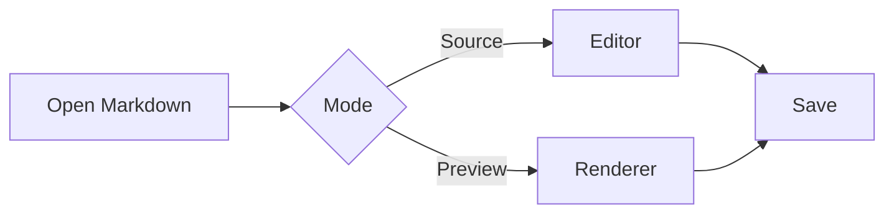
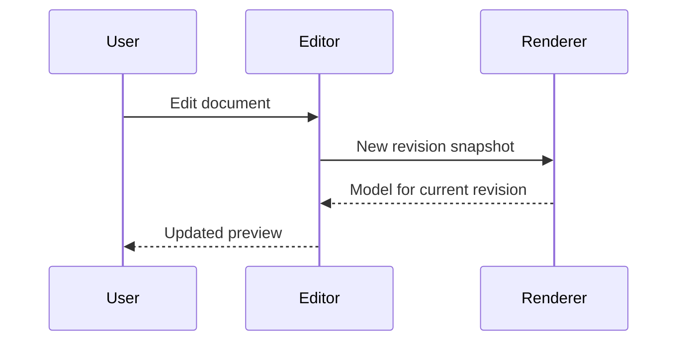
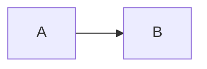

# Mermaid diagrams and mathematical formulas

Markdown rendering examples for TUInk. Press Ctrl+P to open Preview.
The diagrams and formulas below are required rendering examples.
Rendering checks require diagrams and two-dimensional formulas rather than
raw source alone. Presentation may vary between platforms.
Java, Python, JavaScript, Bash, SQL and JSON code examples follow at the end.

## Mermaid flowchart



## Mermaid sequence diagram



## Inline formulas

Euler's identity: $e^{i\pi} + 1 = 0$.
Groups and subscripts: $x_i^{a+b}$.
Numerical formula: $5+2=7$.
A fraction inside a paragraph: $\frac{x^2+1}{y}$.

## Gaussian integral

$$
\int_0^{\infty} e^{-x^2}\,dx = \frac{\sqrt{\pi}}{2}
$$

## Roots of a quadratic equation

$$
x_{1,2} = \frac{-b \pm \sqrt{b^2 - 4ac}}{2a}
$$

## Power tower

$$
2^{3^2} = 512
$$

Grouping changes the result: $(2^3)^2 = 64$.

## Nested radicals

$$
r = \sqrt{2 + \sqrt{2 + \sqrt{2}}} \approx 1.96157
$$

## Exponential series

$$
e^x = \sum_{n=0}^{\infty} \frac{x^n}{n!}
$$

## Matrix inverse

For $ad-bc \ne 0$:

$$
\begin{bmatrix}
a & b \\
c & d
\end{bmatrix}^{-1}
= \frac{1}{ad-bc}
\begin{bmatrix}
d & -b \\
-c & a
\end{bmatrix}
$$

## Heat equation

$$
\frac{\partial u}{\partial t}
= \kappa \frac{\partial^2 u}{\partial x^2}
$$

## Continued fraction

$$
\varphi = 1 + \cfrac{1}{1 + \cfrac{1}{1 + \ddots}}
$$

## Formula in a math block

```math
\frac{x^2 + 1}{y}
```

## Plain text and code

Prices $5 and $10 are ordinary currency text.
Escaped dollar signs: \$5 and \$10.
Inline code `$x^2$` and `\frac{a}{b}` stays literal.

```text
$$ This is text inside a code fence, not a formula $$
flowchart LR
    A --> B
```

The following example shows Markdown inside an ordinary code fence:

````markdown


$$\frac{a}{b}$$
````

## Code highlighting examples

Preview highlights blocks with a specified language automatically. In Source,
**Settings → MD code syntax** enables language-specific styles inside blocks;
when disabled, general highlighting keeps the regular Markdown code style.

### Java: collections, strings and comments

```java
import java.util.List;

final class PreviewDemo {
    /* A multiline comment
       keeps its style on the next line. */
    static int positiveTotal(List<Integer> values) {
        String title = "Markdown preview";
        System.out.println(title);
        return values.stream()
            .filter(value -> value > 0)
            .mapToInt(Integer::intValue)
            .sum();
    }
}
```

### Python: quadratic equation

```python
from math import sqrt


def roots(a: float, b: float, c: float) -> tuple[float, float]:
    """Return two real roots.
    Validate the coefficients before taking the square root.
    """
    discriminant = b * b - 4 * a * c
    if a == 0 or discriminant < 0:
        raise ValueError("Nonzero a and real roots are required")
    delta = sqrt(discriminant)
    return (-b + delta) / (2 * a), (-b - delta) / (2 * a)


print(roots(1, -3, 2))  # (2.0, 1.0)
```

### JavaScript: objects and template strings

```javascript
const examples = [
  { name: "Alpha", value: 3 },
  { name: "Beta", value: -1 },
  { name: "Gamma", value: 5 },
];

const lines = examples
  .filter(({ value }) => value > 0)
  .map(({ name, value }) => `${name}: ${value ** 2}`);

console.log(lines.join("\n"));
```

### Bash: arrays and a loop

```bash
#!/usr/bin/env bash
set -euo pipefail

languages=(java python javascript)
for language in "${languages[@]}"; do
    printf 'Language: %s\n' "$language"
done
```

### SQL: grouping and filtering

```sql
-- Example query against a hypothetical examples table.
WITH totals AS (
    SELECT language, COUNT(*) AS snippets
    FROM examples
    GROUP BY language
)
SELECT language, snippets
FROM totals
WHERE snippets >= 2
ORDER BY snippets DESC, language;
```

### JSON: data and nested objects

```json
{
  "document": "demo_markdown_preview.md",
  "preview": true,
  "limits": {
    "queryUtf16": 4096,
    "matches": 10000
  },
  "languages": ["java", "python", "javascript", "bash", "sql", "json"],
  "selection": null
}
```

## Block quotes

> A regular quote with **emphasis** and `inline code`.
>
> The next paragraph is still part of the same quote.
>
> > A nested quote with its own vertical rule.

> ```python
> def quoted_example():
>     return 42  # Code inside a quote
> ```
