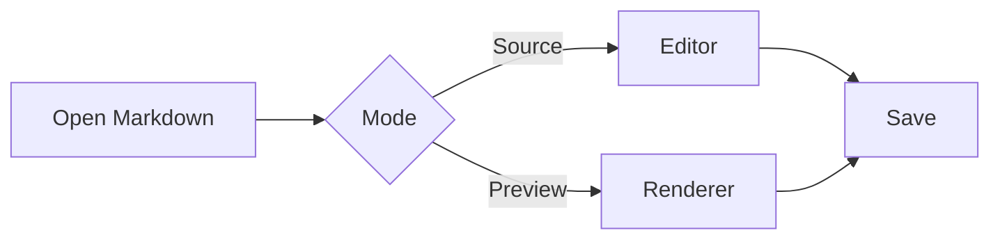
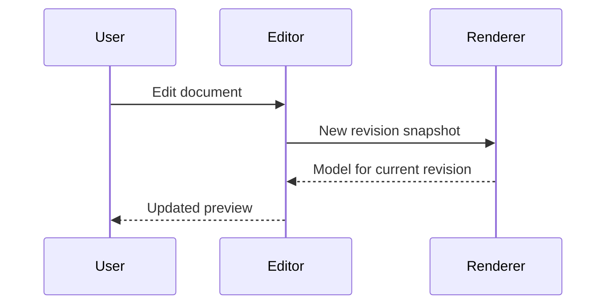

# Mermaid diagrams and mathematical formulas

Markdown rendering examples for TUInk. Press Ctrl+P to open Preview.
The diagrams and formulas below are required rendering examples.
Rendering checks require diagrams and two-dimensional formulas rather than
raw source alone. Presentation may vary between platforms.

## Mermaid flowchart



## Mermaid sequence diagram



## Inline formulas

Euler's identity: $e^{i\pi} + 1 = 0$.
Groups and subscripts: $x_i^{a+b}$.
Numerical formula: $5+2=7$.
A fraction inside a paragraph: $\frac{x^2+1}{y}$.

## Gaussian integral

$$
\int_0^{\infty} e^{-x^2}\,dx = \frac{\sqrt{\pi}}{2}
$$

## Roots of a quadratic equation

$$
x_{1,2} = \frac{-b \pm \sqrt{b^2 - 4ac}}{2a}
$$

## Power tower

$$
2^{3^2} = 512
$$

Grouping changes the result: $(2^3)^2 = 64$.

## Nested radicals

$$
r = \sqrt{2 + \sqrt{2 + \sqrt{2}}} \approx 1.96157
$$

## Exponential series

$$
e^x = \sum_{n=0}^{\infty} \frac{x^n}{n!}
$$

## Matrix inverse

For $ad-bc \ne 0$:

$$
\begin{bmatrix}
a & b \\
c & d
\end{bmatrix}^{-1}
= \frac{1}{ad-bc}
\begin{bmatrix}
d & -b \\
-c & a
\end{bmatrix}
$$

## Heat equation

$$
\frac{\partial u}{\partial t}
= \kappa \frac{\partial^2 u}{\partial x^2}
$$

## Continued fraction

$$
\varphi = 1 + \cfrac{1}{1 + \cfrac{1}{1 + \ddots}}
$$

## Formula in a math block

```math
\frac{x^2 + 1}{y}
```

## Plain text and code

Prices $5 and $10 are ordinary currency text.
Escaped dollar signs: \$5 and \$10.
Inline code `$x^2$` and `\frac{a}{b}` stays literal.

```text
$$ This is text inside a code fence, not a formula $$
flowchart LR
    A --> B
```

The following example shows Markdown inside an ordinary code fence:

````markdown


$$\frac{a}{b}$$
````
