# Complex Mermaid diagrams

Open this document in TUInk and press `Ctrl+P`.
These small diagrams cover different directions, crossings,
labels and messages. Wide diagrams support horizontal scrolling.
The `╪` symbol marks a crossing of independent edges: there is no turn or
junction at that point. The arrowhead at the border identifies each edge's target.

Examples 1–18 use the supported Mermaid subset and should render
as diagrams. Examples 19–20 deliberately use unsupported constructs:
a `[Mermaid: …]` explanation and the source text are expected for them.

## 1. Left to right: LR

Arrows should lead from input to result; labels read from left to right.

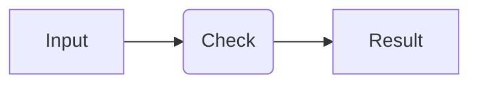

## 2. Right to left: RL

Arrows reverse direction while label characters retain their normal order.

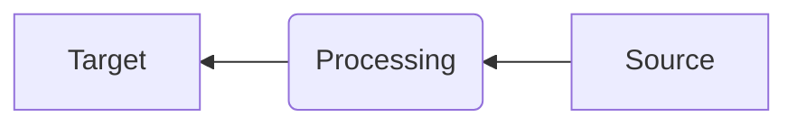

## 3. Top to bottom: TD

Two branches diverge after the check and merge before completion.

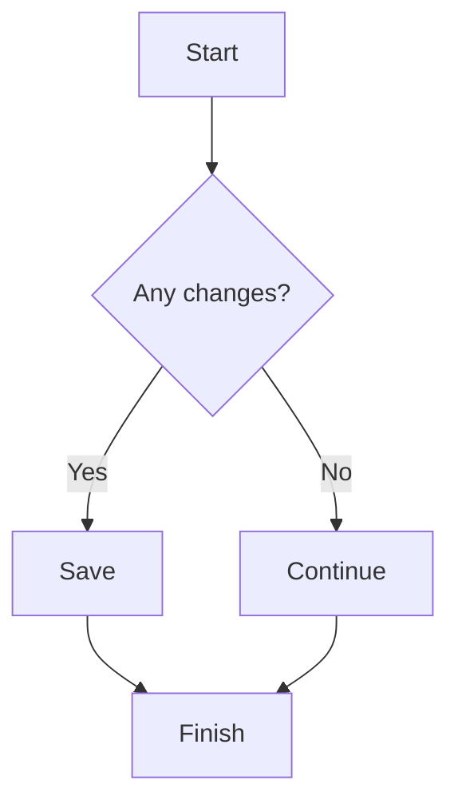

## 4. Bottom to top: BT

The starting point is at the bottom. Arrows enter subsequent nodes from below.

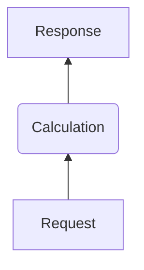

## 5. Decision diamond and branch merge

The decision should be diamond-shaped. Both branch labels stay visible,
and the shared final node appears only once.

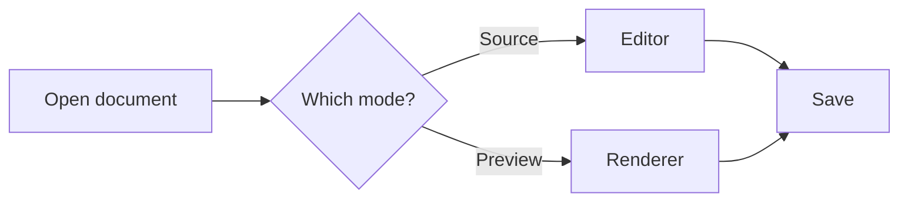

## 6. Two crossing edges

Edge A leads only to D; edge B leads only to C.
The crossing must not become a junction.

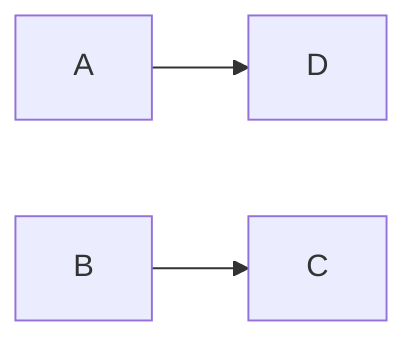

## 7. Two labeled edges between the same nodes

The choice must retain both edges and both labels: Yes and No.
Neither edge should hide the other.

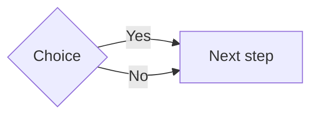

## 8. Multiple lines in a horizontal diagram

Line breaks in nodes and edge labels are preserved. Arrows do not pass
through text and enter node borders.

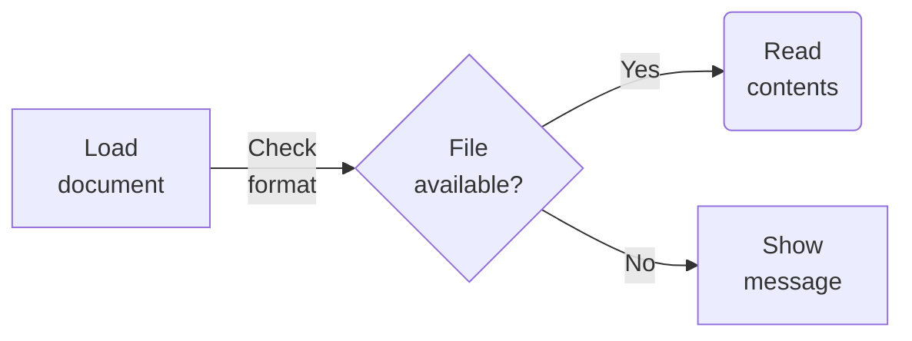

## 9. Multiple lines in a vertical diagram

Edge labels, including two-line labels, should fit between nodes.

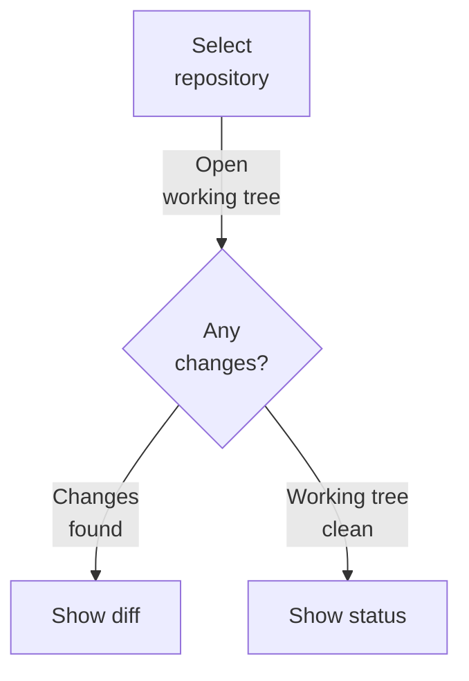

## 10. Edges across intermediate levels

Two long edges appear beside the main chain. Their labels and directions
should remain intact.

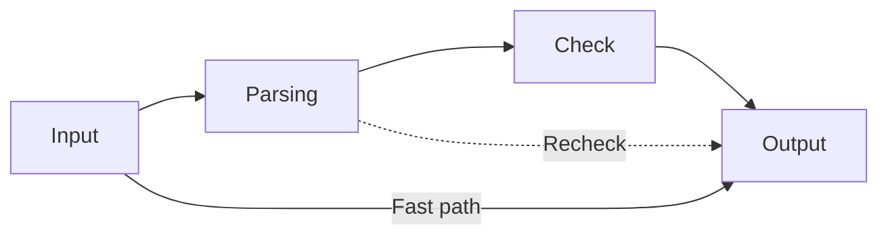

## 11. Solid and dashed edges

Required steps use solid edges; the optional check uses
dashed edges. Both paths remain distinct at the branch.

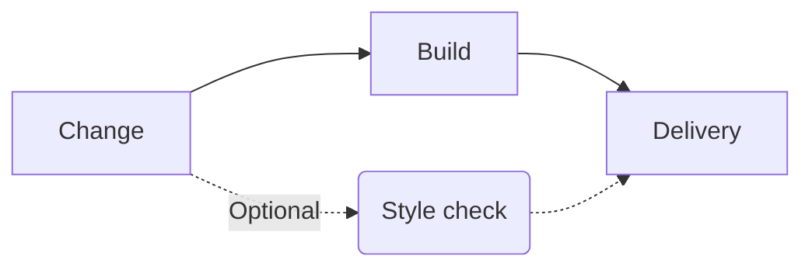

## 12. Large document-processing diagram

Three sources merge into processing, followed by separate paths for errors,
editing and saving. Check the long edge from the file version to the
write check and the transition from Preview to Source: neither should form
junctions with intermediate nodes.

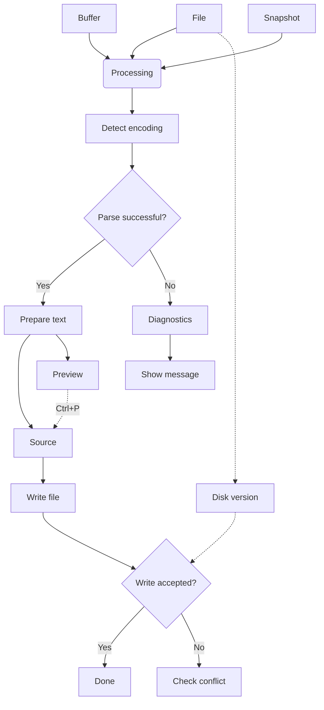

## 13. Wide characters, combining marks and tabs

Borders must remain aligned next to CJK characters and emoji.
The final letter in `Café` is an `e` followed by a separate combining accent.
The last label contains a literal Tab between `name` and `value`.

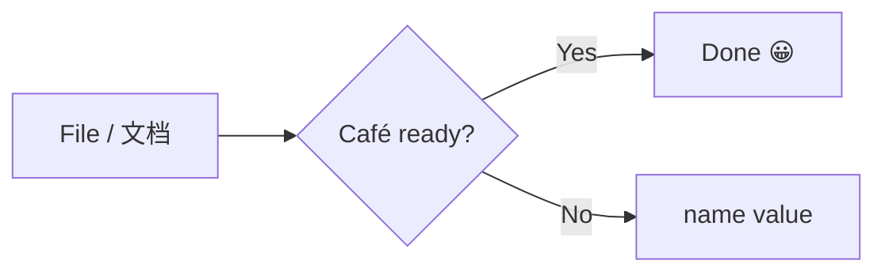

## 14. Sequence: request and reply

Replies use dashed lines in the reverse direction. Messages read
from top to bottom without labels overlapping lifelines.

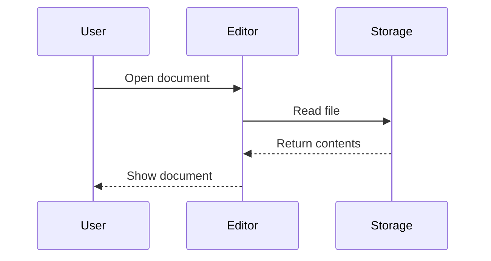

## 15. Actor participant and four lifelines

Participant names and order are preserved; messages can pass
intermediate participants to reach a more distant recipient.

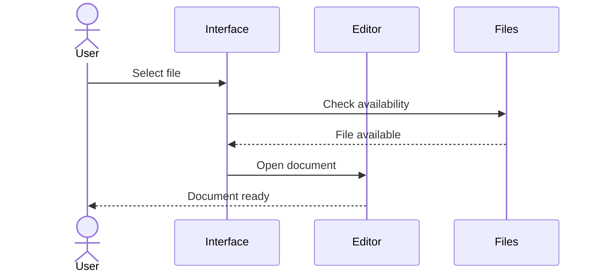

## 16. Headers of different heights

Headers contain one, two or three lines. Each participant's lifeline
should meet its border without gaps above or below.

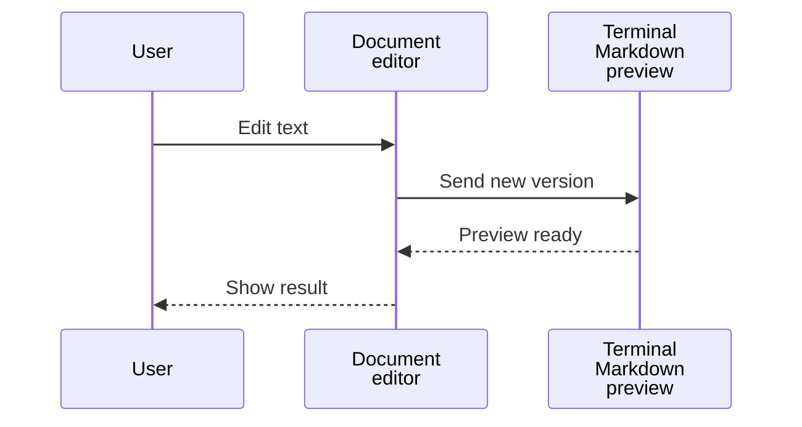

## 17. Self messages

Two self messages form separate loops without obscuring neighboring messages.

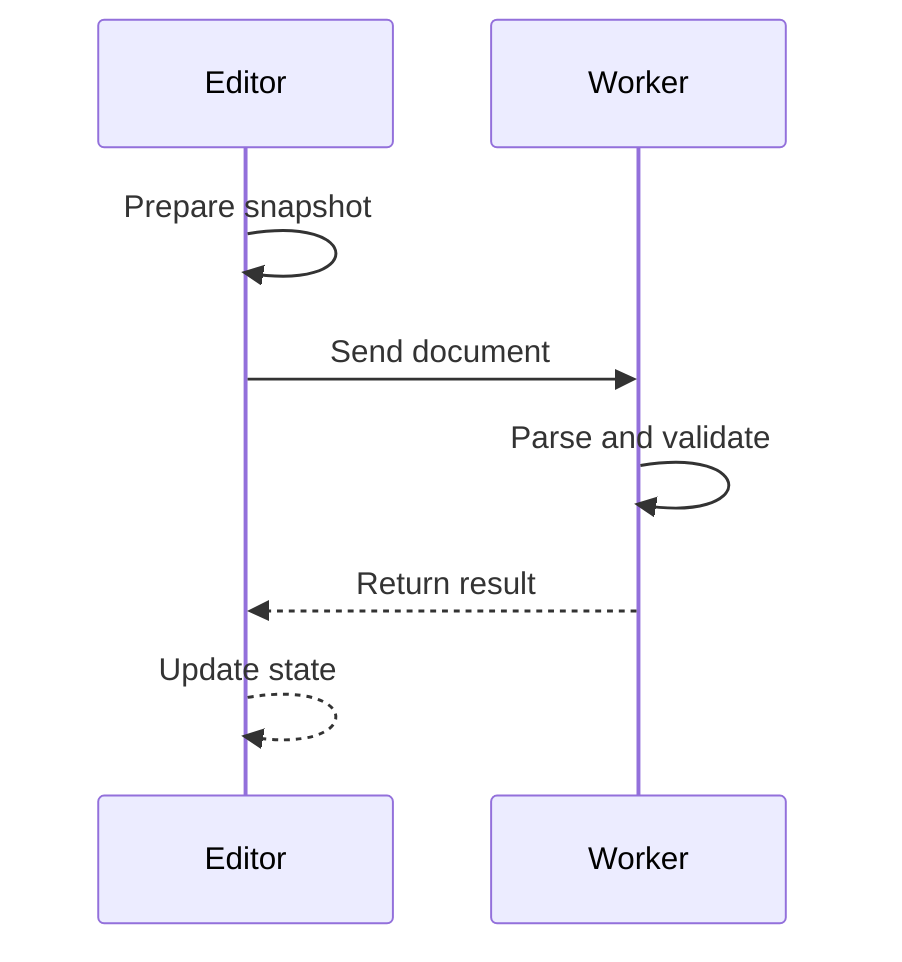

## 18. Long labels and multiple recipients

Message line breaks are preserved. Solid requests and dashed replies
remain distinct, including when crossing an intermediate lifeline.

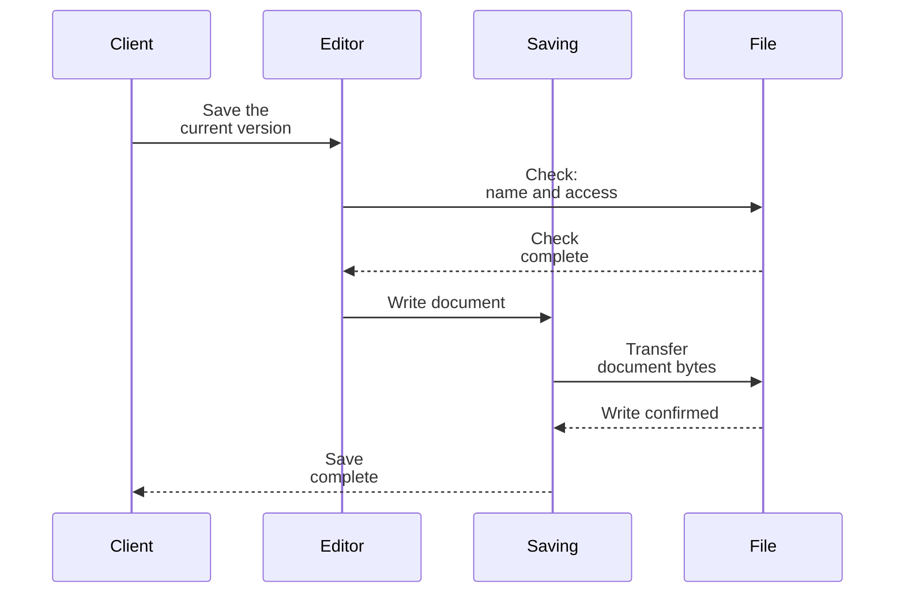

## Deliberately unsupported examples

The next two diagrams check clear refusal. A `[Mermaid: …]` explanation
and the source text are expected here. These examples must not look like
successfully rendered diagrams with missing edges.

### 19. Cyclic flowchart

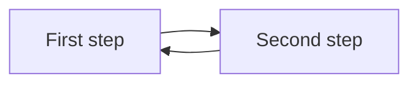

### 20. Subgraph group

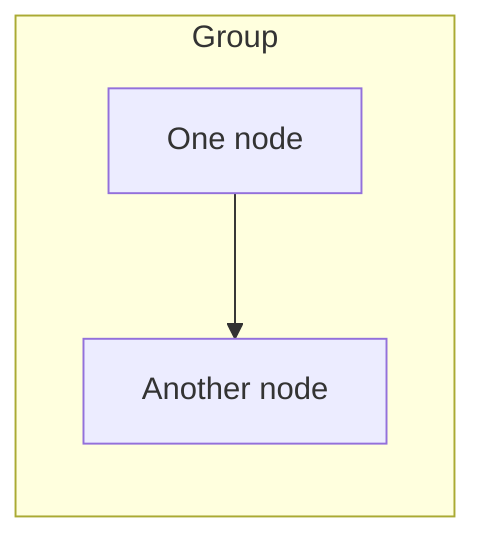
