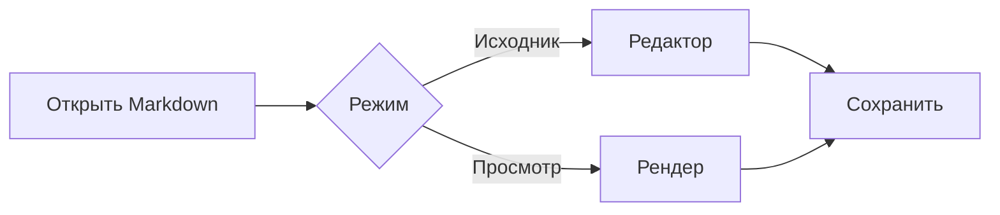
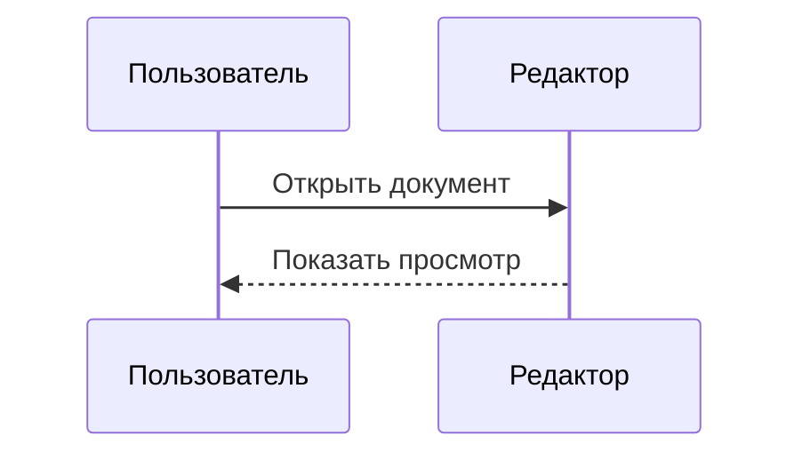

# Просмотр Markdown

В TUInk у Markdown есть вкладки исходника (Source) и просмотра (Preview).
Если открыты обе, Source находится слева, Preview — непосредственно справа.
Выбранная вкладка занимает область документа. По умолчанию файл открывается
только в Source; параметры открытия описаны ниже. Форматированный текст,
таблицы, Mermaid-схемы и двумерные формулы TeX рисуются символами терминала.

`Ctrl+P` или **View → MD Preview** создаёт либо выбирает связанный
просмотр. Из Preview `Ctrl+P` выбирает Source; если редактор уже закрыт,
команда открывает связанный файл с диска в новой вкладке Source слева.
Пункт **MD Preview** находится в начале меню **View** и показывает сочетание
`Ctrl+P`; в просмотре он называется **MD Source**.
Создать или выбрать Preview из Source можно только для файлов Markdown:
`.md`, `.markdown`, `.mdown`, `.mkd`, `.mkdn` (регистр не важен). Для других
типов и безымянных документов пункт меню недоступен; содержимое само по себе
не меняет тип файла. Сначала сохраните новый документ с расширением Markdown.
Нужен шрифт с подходящими Unicode-символами; изображения, браузер, Kitty и
SIXEL не требуются.

Для знакомства откройте
[демонстрационный документ](../apps/tuink/samples/demo_markdown_preview.md).
Отдельный [набор сложных схем Mermaid](../apps/tuink/samples/demo_mermaid_complex.md)
содержит ветвления, пересечения, разные направления и диаграммы
последовательностей. Первые 18 примеров используют поддержанный поднабор;
последние два намеренно показывают локальный отказ для цикла и subgraph.
Из корня репозитория:

```bash
tuink apps/tuink/samples/demo_markdown_preview.md
```

В распакованной поставке демонстрационные файлы находятся в `samples/`.

## Как открывать Markdown

Меню **Settings** содержит два независимых параметра для следующих открытий
файлов Markdown, включая файл из командной строки:

| Open both Markdown tabs | Open Markdown in Preview | Результат |
|---|---|---|
| Выключено | Выключено | Только Source |
| Включено | Выключено | Source и Preview рядом, выбран Source |
| Выключено | Включено | Только Preview; `Ctrl+P` читает файл и открывает Source слева |
| Включено | Включено | Source и Preview рядом, выбран Preview |

Оба параметра по умолчанию выключены. Они не меняют уже открытые вкладки
и не закрывают редактируемые документы при восстановлении recovery.
Ручной `Ctrl+P` по-прежнему создаёт или выбирает вторую часть пары.

В Source для файлов Markdown строка статуса показывает `Ctrl+P: Preview`
сразу после счётчика вкладок, в том числе при единственной вкладке (`Tab 1/1`).

Подсказка `Ctrl+P`, положение курсора, состояние live/snapshot, обновление,
encoding/BOM и результаты поиска находятся в нижней строке статуса.
Постоянного информационного заголовка над документом нет. При `Ctrl+F`
временно появляется строка ввода Find; после Esc место возвращается документу.

Строки статуса Source и Preview используют общую компоновку: позиция, вкладки
и переключение вида находятся слева, режим и метаданные — справа. В Preview
метка `Preview (live/snapshot)` уже обозначает режим чтения; отдельный `READ`
внизу не повторяется. На узком экране поля сокращаются или скрываются целиком;
счётчик вкладок, `Ctrl+P` и режим сохраняются дольше позиции и поиска.

## Связанные вкладки и исходный снимок

Для одного открытого документа существует одна пара Source / Preview. Она
сохраняет порядок и смежность при открытии других документов. Обычные команды
навигации по вкладкам выбирают обе части пары. Повторный `Ctrl+P` выбирает
существующую вкладку.

Пока Source открыт, просмотр получает текущий буфер, включая несохранённые
правки. Перемещение между вкладками сохраняет текст, dirty state и историю
Undo/Redo. Preview доступен для чтения: набор текста, вставка, вырезание,
замена и Undo/Redo в нём не меняют документ. Для правок выберите Source.
У каждой части пары свои выделение, поиск и положение на экране.

`Ctrl+W` закрывает выбранную вкладку. Закрытие Preview оставляет Source
открытым. Закрытие Source проходит обычный вопрос Save / Discard / Cancel;
Cancel сохраняет всю пару. После завершённого закрытия Preview может остаться
с неизменяемым исходным снимком. Он хранит raw Markdown и формат файла,
но не удерживает редактор или его Undo/Redo. Такой снимок не добавляется в
подсчёт dirty документов и recovery, а его закрытие после Discard не вызывает
повторного вопроса о сохранении. Snapshot-вкладки не восстанавливаются после
перезапуска; исходник можно оставить в файле через Save или Save As.

Остаётся последний принятый просмотром исходник. Если первый результат ещё
не готов, используется исходник, захваченный при создании Preview. Поздний
фоновый результат не подменяет этот снимок после закрытия Source.

Save и Save As доступны в Preview. При открытом Source сохраняется актуальный
общий буфер, даже если просмотр ещё обновляется. При закрытом Source
сохраняется raw снимок, включая TeX, Mermaid, code fences, tabs, trailing spaces,
encoding, BOM, точные переводы строк и завершающий перевод строки. Используется
обычный протокол проверки версии, overwrite approval и подтверждения записи.
Save As меняет имя пары и ресурс для следующего открытия только после
подтверждённой записи; сам редактор при этом не открывается. Во время публикации
закрытие и выход ждут результата записи. Неподтверждённый результат оставляет
приложение и снимок открытыми для проверки файла.

Если после Save As файл получил расширение другого типа, уже открытый Preview
сохраняется. Его можно выбрать обычной навигацией по вкладкам, а `Ctrl+P` из
Preview по-прежнему возвращает в Source. Создание или выбор Preview из Source
снова станет доступным после сохранения с расширением Markdown.

Если исходный ресурс недоступен, Save сообщает обычную ошибку и оставляет
снимок доступным. Явный Save As позволяет выбрать новый файл. Его отмена
сохраняет снимок и прежний ресурс. `Ctrl+P` после закрытия Source читает файл
заново: закрытый несохранённый буфер и его история не восстанавливаются.
Ошибка чтения оставляет Preview открытым. Если тот же ресурс уже открыт
в другом Source, выбирается существующий редактор с его текущим буфером.

Разбор и раскладка выполняются в фоне. Во время обновления строка статуса показывает
`updating…`; copy и переходы по содержимому используют актуальный результат.
Скрытый Preview отменяет свой запрос и освобождает тяжёлую раскладку, сохраняя
исходник и навигацию. При возвращении позиция восстанавливается в новой
раскладке; выделение сохраняется при совместимой версии исходника.
Результаты parse/open/save сверяются с идентичностью вкладки, поколением связи
и исходником. Завершение старой задачи не меняет другую вкладку и не возвращает
закрытый редактор.

## Управление

| Действие | Клавиши или мышь |
|---|---|
| Создать или выбрать Preview; из Preview выбрать либо заново открыть Source | `Ctrl+P` или **View → MD Preview / MD Source** |
| Перемещение по содержимому | Стрелки, Page Up / Page Down, Home / End и переходы к началу/концу |
| Выделение | Shift со стрелками; клик, Shift+клик и перетаскивание мышью |
| Выделить всё | `Ctrl+A` |
| Копировать | `Ctrl+C` |
| Прокрутка | Колесо над просмотром; горизонтальное колесо для широкого содержимого |
| Полосы прокрутки | Клик по дорожке и перетаскивание бегунка обеих осей, как в Source |
| Прокрутка с клавиатуры | `Alt+стрелки`; PgUp / PgDn — страница с перекрытием в строку |
| Найти в просмотре | `Ctrl+F`; обычное редактирование поля, выделение и буфер обмена |
| Следующее совпадение | Enter при активном поиске |
| Предыдущее совпадение | `Ctrl+G` при активном поиске |
| Открыть или выбрать связанный Source и перейти к позиции просмотра | `Ctrl+Enter` или **View → Go to source** |
| Закончить поиск / отменить диалог | Esc оставляет Preview выбранным |
| Следующая / предыдущая вкладка, включая обе части пары | `Ctrl+Tab` / `Ctrl+Shift+Tab`; также `Ctrl+PgDn` / `Ctrl+PgUp` |
| Закрыть выбранный Source или Preview | `Ctrl+W` |
| Сохранить raw Markdown / выбрать новое имя | `Ctrl+S` / `Ctrl+Shift+S` (также `Ctrl+K`) |

Клавиши с модификаторами работают, когда терминал передаёт отличимые
последовательности. Пункты меню доступны и при отсутствии нужного сочетания.

Копируется семантическое содержимое, без рамок таблиц и декоративных маркеров.
При отсутствии выделения `Ctrl+C` копирует весь текст просмотра. Формула и
диаграмма при копировании представлены исходным TeX и Mermaid, сохраняя
пригодную для редактирования запись.

Меню **View** содержит дополнительные действия:

- **Copy block source** — скопировать исходное содержимое текущего блока;
  для code, TeX и Mermaid — тело без fences и математических delimiters.
- **Copy table as TSV** — скопировать текущую таблицу с табуляцией между
  ячейками, без нарисованных рамок.
- **Go to source** — выйти из просмотра и перейти к исходнику текущего блока.
- **Follow internal link** — перейти к заголовку по внутренней ссылке
  текущего фрагмента.
- **Next heading** / **Previous heading** — перейти к следующему или
  предыдущему заголовку в просмотре.

Enter продвигает поиск, пока он активен. Вне поиска Enter сохраняет режим
просмотра; переход к исходнику требует отдельной команды.

Поиск Preview использует общий поисковый механизм в семантическом тексте;
формулы и схемы представлены исходной записью. По умолчанию регистр
игнорируется, как в Source. При создании пары наследуются выбранные в Source
параметры регистра и режима совпадений; далее запрос и параметры каждой
вкладки независимы. Поиск Preview локален для данной проекции; параметр
поиска по всем вкладкам не наследуется.

Enter и повторный Ctrl+F переходят к следующему совпадению как из поля,
так и из содержимого. Ctrl+G возвращает к предыдущему. Если запрос пуст,
Ctrl+F из содержимого возвращает фокус полю. Tab/Shift+Tab и мышь меняют
владельца ввода; копирование, выделение и вставка адресуются ему. Длинный
запрос сохраняет видимую часть при переходе в содержимое или диалог.

Лимиты — 4096 UTF-16 единиц запроса и 10 000 неперекрывающихся совпадений.
Wildcard не пересекает логические переводы строк; нелинейная работа
ограничена общим интерактивным бюджетом. При отказе документ и запрос
сохраняются, статус и уведомление объясняют причину вместо ложного нулевого
счётчика. Замена выполняется в исходнике.

## Текст и таблицы

Поддерживаются заголовки, абзацы, выделение, вложенные списки, read-only
checkboxes, цитаты, разделители, ссылки, inline code и блоки кода. Ссылки
выделяются оформлением. Изображения показывают подпись и адрес; raw HTML
остаётся текстом.

GFM-таблицы получают рамки, выравнивание колонок и переносы внутри ячеек.
Ширина измеряется в терминальных ячейках с учётом Unicode. Если минимальная
ширина таблицы больше окна, структура сохраняется и доступна горизонтальная
прокрутка. Строчные формулы могут увеличивать высоту ячейки.

Пробелы и переводы строк в блоках кода и готовых ASCII/Unicode-схемах
сохраняются. Такие блоки не переносятся автоматически. Широкое содержимое
просматривается горизонтальной прокруткой.

Блоки кода имеют тёмно-серый фон на всю ширину области текста, включая
короткие и пустые строки. Дополнительных отступов внутри блока нет;
исходные пробелы и табуляция сохраняются. Обычный текст блока светлый,
а синтаксические токены сохраняют свои цвета. При монохромном выводе
используется обычное оформление терминала.

Цитаты выделяются цветной вертикальной чертой слева. Текст сохраняет
обычную яркость и оформление Markdown; у вложенных цитат несколько черт.
Маркеры являются оформлением и не попадают в скопированный текст.

Блоки кода используют ту же подсветку языков и ту же палитру, что и исходный
редактор: например, `java`, `python`, `js`, `bash` и их поддержанные псевдонимы.
Строки и комментарии могут продолжаться на следующих строках внутри блока;
лексическое состояние не переносится в соседний блок. При неизвестном или
отсутствующем языке применяются общие правила подсветки, как в исходнике.
Между токенами и в строках без токенов используется светлый базовый цвет
блока. Если подсветка блока не уложилась в бюджет, текст также сохраняет
этот базовый цвет. Inline code сохраняет оранжевое
оформление Markdown.

Пункт **Settings → MD code syntax** включает подсветку по языку только внутри
блоков кода во вкладке исходника Markdown (по умолчанию выключен). При
выключенном параметре код сохраняет однотонное оранжевое оформление, как
прежние блоки кода в Preview. Заголовки, списки и остальная Markdown-разметка
подсвечиваются по обычным правилам. Общий переключатель подсветки остаётся
главным для исходника. Значение параметра сохраняется между запусками;
Preview использует собственные готовые цветовые фрагменты.

Подсветка подготавливается фоновым обработчиком вместе с раскладкой и
переиспользуется при прокрутке. Её время обработки и объём цветовых фрагментов
ограничены: при исчерпании лимита оставшийся код сохраняет обычное оформление.
Поиск, выделение и копирование работают с прежним семантическим текстом.

## Mermaid

Блок с языковым тегом `mermaid` превращается в псевдографику:



Поддержанный поднабор flowchart:

- Заголовок `flowchart` или `graph`, направления `LR`, `RL`, `TD`, `TB` и `BT`.
- Ациклические связи, цепочки, ветвления и объединения путей.
- Узлы `A["текст"]`, `A("текст")` и `A{"решение"}`. Узел решения рисуется ромбом.
- Направленные связи `-->`, пунктирные связи `-.->`, подписи через `|текст|`
  или форму `-- текст -->`.
- Идентификаторы из букв, цифр и `_`, Unicode-подписи, объявления узлов
  отдельно от связей и комментарии `%%`.

Каждая связь имеет отдельный порт и наконечник. Подписи располагаются рядом
с линиями и не закрывают их. Маркер `╪` обозначает пересечение независимых
связей без соединения; в этой точке линии продолжаются прямо.

Для диаграмм последовательностей поддерживаются `sequenceDiagram`,
`participant` и `actor`, псевдонимы через `as`, сообщения `->>` / `->` и
пунктирные ответы `-->>` / `-->`, подписи и сообщения самому себе:



Участники получают линии жизни; сообщения сохраняют порядок и направление.
Шапки разной высоты выравниваются, сохраняя соединение с линиями жизни.
Широкая диаграмма сохраняет свои связи при горизонтальной прокрутке.

Циклические flowchart, subgraph, классы и styles, интерактивные директивы,
другие типы Mermaid и произвольный HTML в подписях находятся вне текущего
поднабора. Перенос `<br>` / `<br/>` в подписи поддерживается. Неподдержанная
конструкция показывает исходник в пределах бюджета с локальным пояснением
`[Mermaid: …]`: до 65 536 UTF-16 единиц и 1024 строк, затем `…`.
Она не выдаётся за успешно построенную схему.

## Математические формулы

Используются `$...$` внутри строки, `$$...$$` для отдельного блока и fenced
block `math`. Например:

```math
\int_0^{\infty} e^{-x^2}\,dx = \frac{\sqrt{\pi}}{2}
```

Формулы раскладываются по базовым линиям: числитель находится над знаменателем,
степени и индексы — около своего основания, пределы — у соответствующего
оператора. Вложенные конструкции сохраняют структуру. Форматирование
не вычисляет и не упрощает выражение.

Поддерживаются:

- Группы `{...}`, степени `^` и индексы `_`, включая `2^{3^2}` и `x_i^{a+b}`.
- `\frac`, `\dfrac`, `\tfrac`, `\cfrac`, вложенные и непрерывные дроби.
- `\sqrt` и корень с индексом `\sqrt[n]{...}`.
- `\int`, `\iint`, `\iiint`, `\oint`, `\sum`, `\prod`, `\bigcup`, `\bigcap`
  и пределы `\lim`, `\limsup`, `\liminf` с `_` / `^`.
- Греческие буквы, `\partial`, `\nabla`, `\infty`, отношения, стрелки и
  обычные математические символы.
- Имена функций, например `\sin`, `\cos`, `\log`, `\ln` и `\exp`.
- Парные скобки, `\left...\right`, `\text` / `\operatorname` и интервалы
  `\,`, `\quad`, `\qquad`.
- Окружения `matrix`, `bmatrix`, `pmatrix`, `Bmatrix`, `vmatrix` и `Vmatrix`;
  столбцы разделяются `&`, строки — `\\`.

Гарнитурные команды `\mathrm`, `\mathbf`, `\mathit` и `\mathsf` сохраняют
содержимое без воспроизведения различий математических шрифтов.
Полный TeX, пользовательские макросы и произвольные окружения не поддерживаются.
Неизвестная команда или ошибка сохраняет доступный исходник формулы.

Обычный inline code и code fences не интерпретируются как математика.
Экранированный `\$` остаётся знаком доллара. Валютный текст вроде
`Цена $5 и $10` сохраняется как текст, а `$5+2$` является формулой.

## Ограничения

Помимо пределов входа, модели и раскладки действует общий бюджет окна для
исходных снимков, моделей и результатов. Разделяемые immutable текстовые блоки
учитываются без обязательного копирования. Допустимый для редактирования
документ может оказаться слишком большим для preview. Отказ оставляет Source
и ранее принятые снимки доступными, а просмотр сообщает причину.

| Область | Стандартный предел |
|---|---|
| Markdown-вход | 2 097 152 UTF-16 единицы |
| Markdown-модель | 100 000 узлов, вложенность 96, 20 000 ячеек таблиц |
| Общая раскладка | 20 000 строк, до 4096 терминальных ячеек в строке |
| Таблица | До 64 колонок |
| Одна формула | 32 768 UTF-16 единиц, вложенность 48, 8192 узла |
| Матрица | До 32 строк и 32 колонок |
| Раскладка формулы | До 4096 × 512 ячеек, бюджет создаваемых boxes 2 000 000 ячеек |
| Один Mermaid-блок | 65 536 UTF-16 единиц, 128 узлов/участников, 256 связей/сообщений |
| Подпись Mermaid | До 1024 UTF-16 единиц |
| Раскладка Mermaid | До 1024 × 8192 ячеек и 1 048 576 ячеек суммарно |
| Маршрутизация Mermaid | До 8 388 608 шагов построения маршрутов |

Эти пределы ограничивают разные этапы и не означают, что каждая их комбинация
поместится в оставшуюся память. Слишком широкие блоки получают прокрутку
в пределах бюджета. Ошибка отдельного обработчика сохраняет доступный
исходник; превышение общего бюджета может отменить весь preview.

## Границы модулей и будущие платформы

`markdown-preview` владеет immutable моделями, исходными диапазонами,
текстовой проекцией и контрактами providers. `markdown-commonmark` адаптирует
CommonMark; `markdown-math` и `markdown-mermaid` реализуют поддержанные
поднаборы без внешнего graphics runtime. Терминальная раскладка находится
в `render`, а ввод, viewport, фоновые workers и рисование окна — в `tui`.

`editor-contract` содержит полный immutable `FrozenDocumentSource` — текст,
формат и resource binding. `editor-session` хранит единый реестр представлений
и общий протокол сохранения для живого документа и `FrozenDocumentSession`;
закрытый снимок не создаёт editing session. Редакторский движок, сессия
документов и TUIframe не зависят от Markdown.
Общие модули используют Java 17 API/bytecode и проверяются внешними JVM/D8/R8
consumers. Android и desktop смогут подключить свою геометрию, шрифты,
отрисовку, clipboard и lifecycle к тем же моделям. Android frontend,
платформенные storage adapters и ART/UI-проверки остаются отдельной работой.

Подробности границ и этапов находятся в
[архитектурной дорожной карте](architecture-roadmap.md) и
[архитектура](architecture-roadmap.md),
[архитектура](architecture-roadmap.md) и
[ADR владения парой](adr/0007-paired-markdown-presentations.md).

Стрелки перемещают видимый курсор по строкам раскладки, включая внутренние
строки формул и схем. Положение показано в заголовке просмотра. Колесо и
клавиатурная прокрутка сохраняют согласованное положение курсора и viewport;
после прокрутки стрелка продолжает работу с видимого участка. Атомарное
копирование формул и Mermaid остаётся свойством семантического выделения.
